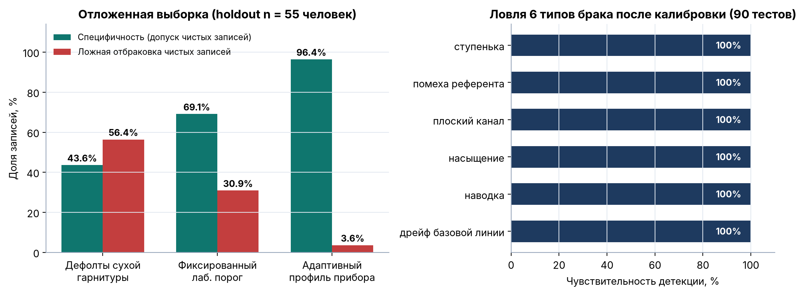
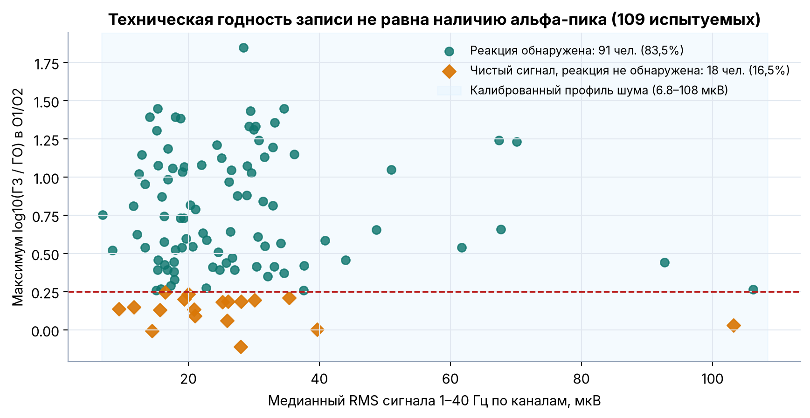
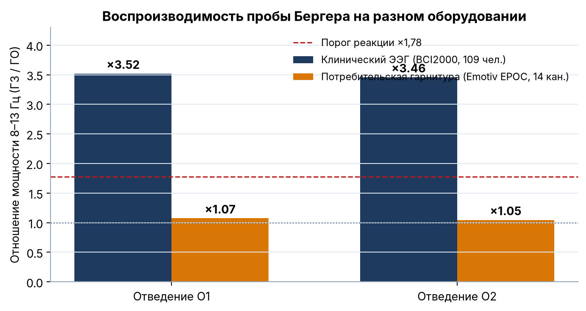

# EEG QC Passport (v0.6.0)

Локальный инструмент автоматического контроля качества учебных и лабораторных ЭЭГ-записей и стандартной пробы закрытия/открытия глаз (реакция Бергера, 8–13 Гц).

Проект решает типовую проблему нейрофизиологического практикума: студент не всегда успевает распознать оторванный электрод, соляной мостик или проблему референта до начала записи, а отсутствие альфа-пика на спектре ошибочно принимается за поломку прибора или ошибку студента.

---

## Что делает движок

1. **Онлайн-проверка при постановке электродов (`check_live_window`)** — по короткому окну 2–4 с показывает светофор по каналам (`PASS / WARN / FAIL`) и выдаёт конкретные подсказки на русском языке до старта записи («поправьте контакт O1», «проверьте референтный электрод», «отодвиньте блок питания — наводка 50 Гц», «попросите испытуемого расслабить челюсть — ЭМГ»).
2. **Разделение технического качества сигнала и физиологической реакции** — вердикт по качеству записи (`PASS / PASS_WITH_WARNINGS / BLOCK`) выносится независимо от выраженности альфа-ритма. При чистом сигнале без прироста 8–13 Гц выдаётся формулировка *«реакция не обнаружена»* с пояснением об индивидуальном низкоамплитудном / десинхронизированном типе ЭЭГ (по классификации Е. А. Жирмунской). При техническом браке физиологический расчёт блокируется.
3. **Автокалибровка порогов под профиль прибора (`calibrate_b.py`)** — устраняет избыточную отбраковку при переносе правил между гарнитурами и клиническими энцефалографами с разной схемой референта, АЦП и входным сопротивлением.
4. **Контролируемые технические и физиологические признаки (v0.6.0):**
   - технические: обрыв контакта (плоский канал), насыщение усилителя, сетевая наводка 50/60 Гц, ступеньки потенциала, линейный дрейф базовой линии, локальный соляной мостик (`r > 0.995`), глобальная перекрёстная помеха референта (`crosstalk`), подэлектродный импеданс (при передаче прибором в кОм);
   - физиологические (выделяются отдельно и вырезаются перед расчётом спектра): глазодвигательные артефакты морганий (ЭОГ, 0,5–10 Гц) и высокочастотная мышечная активность (ЭМГ, 30–45 Гц).
5. **Самодостаточный HTML-паспорт записи (`render_html_passport`)** — отчёт на русском языке без внешних сетевых зависимостей с версией правил, хэшем параметров и контрольными суммами `SHA-256` исходных EDF-файлов (исходные файлы никогда не перезаписываются).

---

## Результаты вычислительной проверки на открытых данных

### Исследование 1 — PhysioNet EEG Motor Movement/Imagery Dataset v1.0.0
109 здоровых испытуемых, 218 EDF-файлов (клиническая система BCI2000, 64 канала, 160 Гц, пробы с открытыми и закрытыми глазами R01/R02; лицензия ODC-By 1.0). Калибровка профиля выполнена на первой половине выборки (`n = 54` по MD5-хэшу ID), проверка — на независимой отложенной выборке (`holdout n = 55`):

| Режим проверки на holdout (`n = 55`) | Специфичность (допуск чистых записей) | Ложная отбраковка (FPR) | Чувствительность к 6 типам брака (90 тестов) |
|---|---:|---:|---:|
| Дефолты сухой гарнитуры без калибровки | 43,6% | 56,4% | 100,0% |
| Фиксированный лабораторный порог | 69,1% | 30,9% | 100,0% |
| **Адаптивный профиль прибора (v0.6.0)** | **96,4%** | **3,6%** | **100,0%** |






По всем 109 испытуемым после калибровки:
- медианный прирост мощности 8–13 Гц при закрытии глаз в затылочных отведениях: **×3,52** (`O1`) и **×3,46** (`O2`) против **×1,42–1,71** во фронтальных каналах;
- выраженная затылочная реакция (`≥ ×1,78`) наблюдается у **83,5%** испытуемых (91 чел.);
- у **16,5%** здоровых испытуемых (18 чел., напр. `S005`, `S051`) при технически чистой записи альфа-реакция не выражена — движок корректно относит такие записи к технически годным со статусом *«реакция не обнаружена»*.

### Исследование 2 — UCI EEG Eye State (потребительская гарнитура Emotiv EPOC)
14 каналов, 128 Гц, 14 980 эпох с синхронной видеометкой положения век (`CC0-1.0`):
- отношение мощности 8–13 Гц ГЗ/ГО в `O1/O2` составляет **×1,05–1,08** (максимум по всем каналам **×1,17** против **×3,52** на клинической системе), что показывает необходимость предварительной валидации учебного упражнения под конкретный класс гарнитуры;
- детектор морганий во фронтальных каналах (`AF3`, `AF4`, `F7`) без машинного обучения совпадает с видеометкой открытых глаз в **80–88%** событий;
- постоянное смещение `~4000 мкВ` автоматически блокируется проверкой профиля прибора до калибровки.




---

## Быстрый старт и воспроизведение с нуля

```bash
pip install -r requirements.txt

# 1. Быстрая проверка движка и автотесты (без загрузки датасетов, ~2 с)
python3 qc_engine.py
pytest -v test_qc.py

# 2. Полное воспроизведение обоих исследований (~300 МБ открытых данных, без ключей API)
bash fetch_all.sh
python3 run_study.py
python3 calibrate_b.py
python3 run_study_consumer.py
python3 make_passports.py
python3 make_figures.py
```

Готовые таблицы, сводки JSON, графики `fig1..fig5` и примеры HTML-паспортов (`passport_S001_alpha.html`, `passport_S005_desync.html`, `passport_S001_broken_setup.html`) сохраняются в каталоге `results/`.

---

## Ограничения текущей версии
- Порог насыщения `1000 мкВ` при автокалибровке задан как консервативная инженерная граница клиппинга (на чистых записях реальный предел АЦП напрямую не наблюдается) и уточняется по паспорту конкретного усилителя.
- На очных студенческих записях со слепой разметкой двух независимых нейрофизиологов планируется отдельная пилотная валидация (целевые ориентиры пилота: чувствительность `≥ 90%`, специфичность `≥ 95%`).
- Программа предназначена для учебного практикума и исследовательского предконтроля данных; медицинским изделием не является и клинических диагнозов не ставит.

## Лицензия и авторство
Код распространяется под лицензией MIT (`LICENSE`). Автор: Анна Соколова (АБиМ ЮФУ). Научный консультант проекта: Д. М. Лазуренко, старший научный сотрудник АБиМ им. Д. И. Ивановского ЮФУ.
